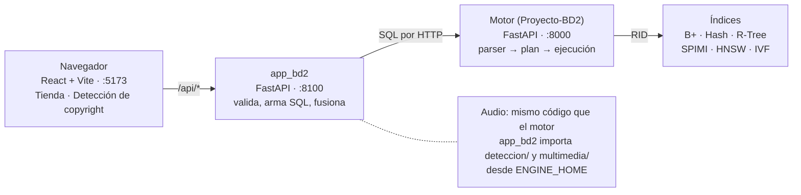
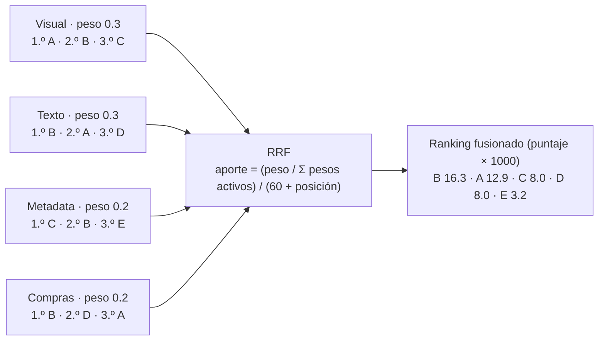
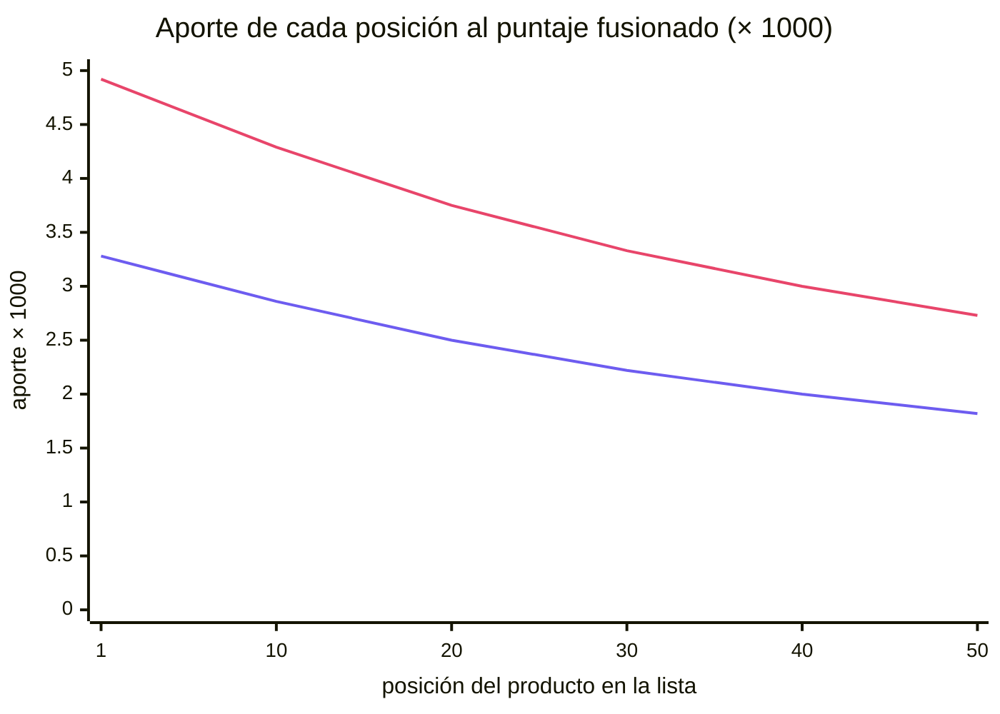
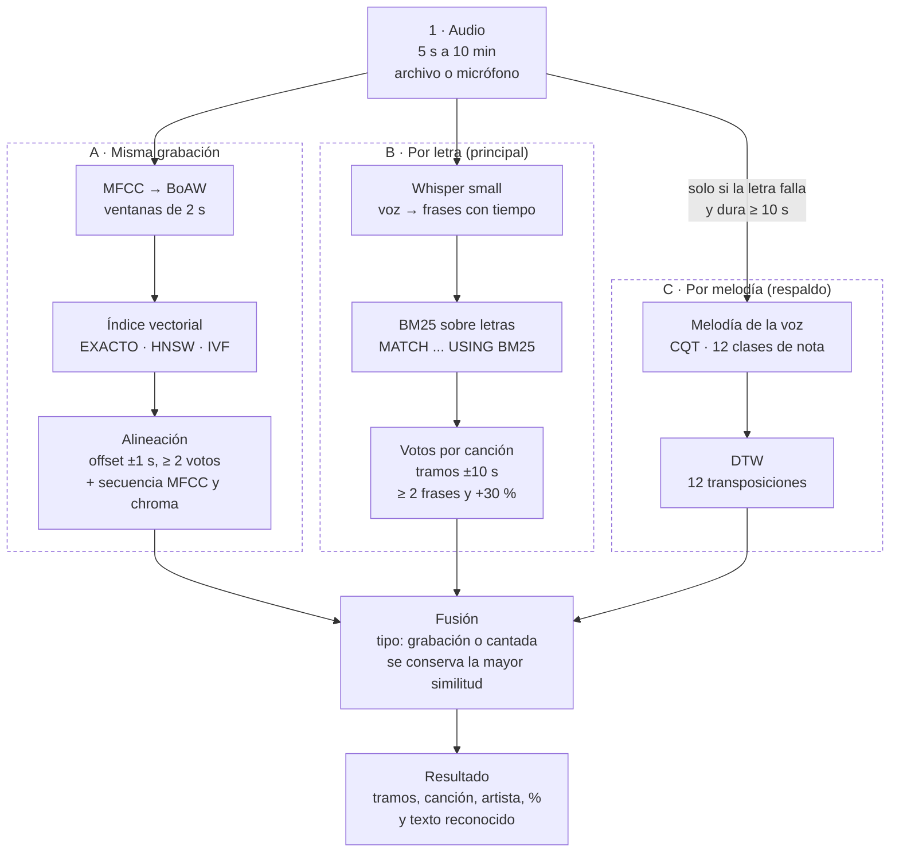
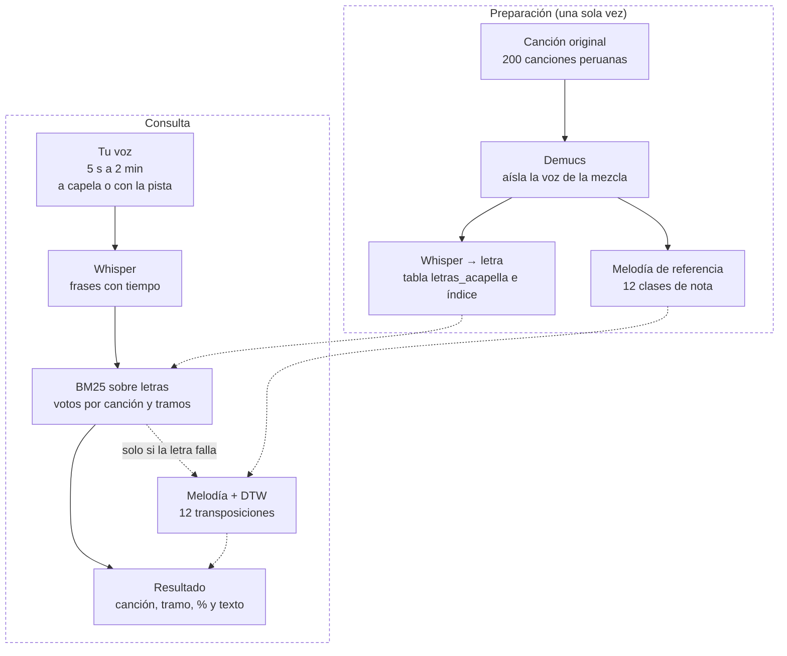

# Aplicaciones-BD2

Dos aplicaciones construidas sobre el Minigestor multimodal ([Proyecto-BD2](https://github.com/iranalvarez27/Proyecto-BD2)) sin modificar su código:

| Aplicación | Qué hace | Partes del motor que usa |
|---|---|---|
| **Tienda** (e-commerce híbrido) | Catálogo, búsqueda, recomendación de productos, sucursales con stock y compras. | B+ Tree, Hash, R-Tree, SPIMI (BM25 / TF-IDF), HNSW / IVF y transacciones |
| **Detección de copyright** (audio) | Detecta fragmentos de canciones originales y también canciones del repertorio cantadas por ti (por su letra), en un solo resultado. | Vectores BoAW con EXACTO / HNSW / IVF y metadatos por SQL |



Cada consulta deja una traza (SQL, plan y tiempo) que la interfaz puede mostrar. Por defecto la Tienda no pasa por `app_bd2`: usa el API `/api/ecommerce` del motor a través del proxy de Vite, y `app_bd2` atiende audio, subidas, medios y salud.

Todo lo que el sistema "sabe" (tablas, índices y transacciones) vive en el motor. Esta carpeta valida la petición, arma consultas SQL, combina los resultados y los entrega al frontend.

---

## 1. Puesta en marcha

```bash
# 1) Motor (Proyecto-BD2) en :8000, con los datos ya preparados
cd Proyecto-BD2
python3 -m recomendacion.preparar --size 1000        # tienda (con el backend detenido)
pip install demucs                                   # opcional: voz aislada para el repertorio cantado
python3 -m deteccion.acapella preparar               # repertorio cantado: 200 canciones peruanas (una sola vez, ~8 h en CPU)
python3 -m deteccion.letras preparar                 # letras de esas canciones (Whisper, ~4 h más en CPU)
python3 -m uvicorn backend.main:app --port 8000

# 2) Aplicaciones en :8100
cd Aplicaciones-BD2
pip install -r requirements.txt
python -m app_bd2.main

# 3) Frontend en :5173
cd Aplicaciones-BD2/frontend
npm install && npm run dev
```

En Windows (PowerShell) el entorno de Python vive en `Proyecto-BD2\.venv` y sirve para los dos backends. Tres terminales:

```powershell
# 1) Motor, puerto 8000
cd Proyecto-BD2
.venv\Scripts\activate
python -m uvicorn backend.main:app --port 8000

# 2) Aplicaciones, puerto 8100
cd Aplicaciones-BD2
..\Proyecto-BD2\.venv\Scripts\activate
python -m app_bd2.main

# 3) Interfaz, puerto 5173
cd Aplicaciones-BD2\frontend
npm install
npm run dev
```

Abre `http://localhost:5173` (con `localhost`: el navegador solo permite el micrófono en `localhost` o con HTTPS). `http://localhost:8100/api/health` debe responder `"engine": "ok"`. Pensado para computadora.

| Variable | Valor por defecto | Para qué sirve |
|---|---|---|
| `ENGINE_URL` | `http://127.0.0.1:8000` | Dirección del motor |
| `ENGINE_TIMEOUT` | `600` | Segundos de espera por consulta |
| `ENGINE_HOME` | `../Proyecto-BD2` | Carpeta del motor, de donde se importan `deteccion/` y `multimedia/` |
| `MEDIA_BASE_URL` | vacío | Servidor alternativo para escuchar los audios originales |
| `PORT` | `8100` | Puerto de esta aplicación |

> **Proxy del frontend.** En `frontend/vite.config.js` la regla `/api/ecommerce` está antes que `/api` y apunta al **motor**, y eso es lo correcto: la Tienda usa `/api/ecommerce/best-sellers`, `/stores` y `/stores/nearby`, que solo existen en el motor (`app_bd2` no los implementa). No cambies esa regla a `APPS_URL` o esas pantallas darán 404. `app_bd2` atiende audio, subidas, medios y salud.

---

## 2. Estructura

| Pieza | Archivo | Responsabilidad |
|---|---|---|
| Entrada | `app_bd2/main.py` | Crea la app FastAPI, monta los routers, `GET /api/health`, subida de archivos (máx. 50 MB, extensiones permitidas, nombre con UUID) y reenvío por *streaming* de `/api/media/*` al motor respetando `Range`. |
| Cliente del motor | `app_bd2/engine_client.py` | `ConexionHTTP`: ofrece la misma interfaz que la conexión interna del motor (`execute`, `catalog.existe_tabla`, `lock_manager.acquire`, `txn_manager.is_active`), pero cada llamada viaja por HTTP. |
| Tienda | `app_bd2/ecommerce/` | `router.py` (API y validación), `servicio.py` (catálogo, detalle, recomendación), `fusion.py`, `afinidades.py`, `compras.py`, `disponibilidad.py`, `repositorio.py` (SQL con trazas). |
| Audio | `app_bd2/audio/router.py` | Bibliotecas y detección de copyright; la canción cantada por melodía se registra con `backend.audio_detection.agregar_acapella` y la de letras con `agregar_letras`, las mismas funciones del motor. |
| Frontend | `frontend/src/components/` | `ECommercePanel.jsx` con `ecommerce/`, y `AudioCopyrightPanel.jsx` con `audio/`. |

**Locks sin sentencia `LOCK`.** `engine_client._Locks.acquire` ejecuta `DELETE FROM tabla WHERE id = -1` dentro de la transacción. No borra nada, pero obliga al motor a tomar el lock exclusivo de la tabla.

---

## 3. Tienda: recomendación híbrida

> **Qué API usa realmente la Tienda.** Con la configuración por defecto, la interfaz consume el e-commerce del **motor** (`Proyecto-BD2/recomendacion`: combinación convexa de las cuatro señales con pesos 0.25 y 10 endpoints). Esta sección documenta `app_bd2/ecommerce`, una implementación alternativa y más pequeña (fusión por RRF, 7 endpoints) que sirve para ver cómo se arma una recomendación híbrida sobre SQL; no incluye *más vendidos* ni el listado de sucursales.

### 3.1 Cómo se arma una recomendación

`Servicio.recomendar` pide cuatro listas ordenadas al motor y las fusiona:

| Señal | Consulta al motor | Puntaje original |
|---|---|---|
| `visual` | `SIMILAR_TO(ruta, k=L) USING HNSW \| IVF \| EXACT WITH METRIC=...` | `SIMILARITY_SCORE()` (se descartan los ≤ 0) |
| `texto` | `MATCH(contenido, <hasta 40 palabras del nombre y la descripción>) USING BM25 \| TF_IDF` | `SCORE()` |
| `metadata` | Productos de la misma categoría | `2·(misma subcategoría) + (misma marca) + 1/(1 + \|Δprecio\|/precio)` |
| `compras` | `ecommerce_afinidades WHERE producto_origen = id` | afinidad item-item |



B gana porque aparece arriba en las cuatro listas. BM25, coseno y afinidad tienen escalas distintas; las posiciones sí se pueden sumar.

La fusión es **Reciprocal Rank Fusion ponderado** (`fusion.py`, pesos 0.3 / 0.3 / 0.2 / 0.2). Usa la posición y no el puntaje, porque BM25, coseno y afinidad tienen escalas que no se pueden sumar. Los pesos se normalizan solo entre las señales que devolvieron algo, así que una señal vacía no penaliza a las demás.



Línea superior: peso 0.3; línea inferior: peso 0.2. Aporte = peso / (60 + posición). La constante 60 aplana la curva: el 1.º no aplasta al 10.º.

Se piden `L = min(M, max(100, 10·k))` candidatos por señal. Si después de filtrar (stock, categoría, precio) quedan menos de `k`, `L` se duplica y se repite hasta completar o agotar el catálogo.

### 3.2 Endpoints (`/api/ecommerce`)

| Método y ruta | Función |
|---|---|
| `GET /status` | Si existen las 10 tablas `ecommerce_*` y hay productos (caché de 10 s). |
| `GET /catalog` | Catálogo paginado. Sin búsqueda: paginación *keyset* por `id`. Con búsqueda: BM25 y cursor `token.posicion`. Filtros por categoría y precio. |
| `GET /products/{id}` | Detalle y descripción. |
| `POST /recommend` | Top-K híbrido con pesos, método, métrica, filtros, "solo con stock" y ubicación. |
| `GET /products/{id}/stores` | Sucursales con stock, por distancia si se envía `lat` y `lon`. |
| `POST /interactions` | Evento `vista` o `carrito`. |
| `POST /purchases` | Compra atómica e idempotente. |

Validaciones: `k` de 1 a 50, `lat` y `lon` juntas, `min_price ≤ max_price`, cantidad de 1 a 100, hasta 20 líneas por compra y `solicitud` solo con `[A-Za-z0-9_-]`.

### 3.3 Funciones y complejidad

`M` = productos, `k` = resultados, `L` = candidatos por señal, `P` = productos distintos en las listas, `E` = eventos, `b` = tamaño de la cesta de un usuario.

| Función | Qué hace | Complejidad |
|---|---|---|
| `fusionar` | Suma `(peso / Σ pesos activos) / (60 + posición)` por producto, calcula `aportes_pct` y ordena. | `O(4·L + P log P)` |
| `calcular_afinidades` | Cuenta pares comprados por el mismo usuario; `score = soporte / √(n_a · n_b)`; guarda los 100 mejores vecinos. | `O(Σ b²)` |
| `refrescar` | Recalcula las afinidades y sincroniza la tabla: borra, inserta y actualiza solo lo que cambió. | `O(E + Σ b² + P)` por compra |
| `comprar` | Transacción con locks ordenados, idempotencia y descuento de stock. | `O(líneas · log M)` más `refrescar` |
| `Servicio.catalogo` | *Keyset* sin búsqueda; con búsqueda guarda hasta 500 ids en caché (5 min, 64 consultas). | `O(log M + límite)` o `O(Σ df)` |
| `Servicio.recomendar` | Cuatro listas, filtros y fusión. | Dominado por `SIMILAR_TO` y `MATCH` |
| `tiendas_con_stock` | Sucursales con `stock > 0` ordenadas por `distancia_haversine`. | `O(S)` |

### 3.4 Compras

1. Valida las líneas y calcula `firma = SHA-256` del pedido ordenado.
2. `BEGIN` y lock exclusivo sobre las cinco tablas, siempre en orden alfabético: un orden global evita interbloqueos.
3. Si la `solicitud` ya existe con la misma firma y usuario, devuelve la respuesta guardada; con otro contenido, la rechaza.
4. Por cada línea exige `stock ≥ cantidad`. Si una falla, `ROLLBACK` de todo el pedido.
5. Descuenta, registra la compra, refresca afinidades y `COMMIT`.

### 3.5 Casos borde

| Situación | Comportamiento |
|---|---|
| Faltan tablas `ecommerce_*` | `400` con la instrucción para preparar el catálogo |
| Búsqueda sin resultados | Lista vacía, sin error |
| Más de 500 coincidencias | Se guardan 500 y se marca `busqueda_acotada` |
| Cursor vencido o filtros cambiados | `400`: reiniciar la búsqueda |
| Producto nuevo sin compras | `compras` queda `sin_datos` y su peso se reparte entre las otras señales |
| Falla la búsqueda visual | Esa señal queda en `error`; la recomendación continúa |
| Todos los pesos en 0 | Error de validación |
| Stock insuficiente | `400` y `ROLLBACK` |
| Misma `solicitud` reenviada | Misma respuesta, un solo descuento |
| Motor apagado | `/api/health` responde `degraded` |

### 3.6 Decisiones

| Decisión | Ventaja | Costo |
|---|---|---|
| RRF en lugar de sumar puntajes | No requiere normalizar escalas y es explicable (`aportes_pct`) | Ignora cuánto mejor es el primero que el segundo; la constante 60 y los pesos son heurísticos |
| Afinidad item-item | Simple y determinista | Arranque en frío; se recalcula en cada compra |
| Locks de tabla | Correctitud fácil de razonar, sin sobreventa | Poca concurrencia entre compras |
| Paginación *keyset* | Costo estable aunque se avance mucho | No permite saltar a una página arbitraria |

El motor tiene su propia versión del e-commerce (`Proyecto-BD2/recomendacion`), con otra fusión y otros modelos; su documentación está en el README del motor.

---

## 4. Detección de copyright

La pestaña **Copyright audio** es **una sola pantalla** con tema claro y oscuro: subes un archivo o grabas una toma, pulsas **Analizar** y el sistema busca a la vez dos cosas. (1) **Misma grabación**: fragmentos de originales de la biblioteca (timbre). (2) **Canción cantada**: si cantas una canción del repertorio, a capela o con música de fondo, la reconoce por su **letra** (Whisper + búsqueda BM25 sobre el índice invertido del motor); si la letra no basta y el audio dura ≥ 10 s, usa la **melodía** como respaldo. Todo sale en el mismo timeline, con una etiqueta por tramo: *Misma grabación*, *Canción cantada (letra)* o *Canción cantada (melodía)*. Debajo aparece el **texto reconocido**.

### 4.1 Detector de copyright



La consulta (5 s a 10 min) se corta en ventanas de 2 s cada 0.5 s. Cada ventana se convierte en un vector BoAW y busca sus vecinos en la biblioteca. Un vecino parecido no prueba nada: se exige que varios instantes caigan, de forma coherente en el tiempo, sobre la misma pista, y después se verifica contra el original.

| Etapa | Función (`Proyecto-BD2/deteccion/`) | Complejidad |
|---|---|---|
| Parámetros | `Parametros.validar`: bloque 5–10 s, paso 0.1–1 s, `k` 1–200, `min_votos` 2–20 | `O(1)` |
| Búsqueda | `BusquedaAudio`: EXACTO, HNSW (`M=32`) o IVF (`nlist ≈ √N`) | `O(Q·N·d)` exacto; `~O(Q·log N)` HNSW |
| Votos | `Detector.detectar`: lotes de 32 ventanas, omite las silenciosas | `O(W)` búsquedas |
| Alineación | `alinear`: mismo *offset* ±1 s, ≥ 2 votos, velocidades 0.95 / 1.0 / 1.05 | `O(h log h)` por pista |
| Fusión | `fusionar`: une alineaciones consecutivas en eventos | `O(S·E)` |
| Verificación | `verificar_secuencia`: correlación MFCC por FFT (umbral 0.60) | `O(L log L · d)` por pista |
| Tonal | `chroma.verificar_tonal`: chroma + DTW, solo si dura ≥ 10 s | `O(n·m)` |

Se indexan segmentos de 2 s, pero se decide en bloques de 5 a 10 s: un clip aislado daría muchos falsos positivos.

### 4.2 Canción cantada: letra y melodía



**Por letra (ruta principal).** `deteccion/letras.py` transcribe la toma con Whisper `small`, busca cada frase con `MATCH ... USING BM25` en la tabla `letras_acapella`, suma votos por canción y une las frases que apuntan al mismo pasaje de la original. Se reporta solo con ≥ 2 frases (o una de ≥ 6 palabras exacta) y si supera a la segunda canción por ≥ 30 %. Las letras se preparan una vez con `python -m deteccion.letras preparar` o con el botón **Preparar letras**. Resultados y límites: sección 2.6.4 del README de Proyecto-BD2.

**Por melodía (respaldo).** Compara la **melodía**, no el timbre. De cada canción del repertorio se aísla la voz con Demucs y se guarda su melodía en 12 clases de nota; la toma del usuario pasa por el mismo extractor y se compara con DTW en las 12 transposiciones. Cantar en otro tono o más lento no cambia el resultado. La implementación está en `Proyecto-BD2/deteccion/acapella.py`.

| Paso | Costo |
|---|---|
| Preparar una canción (una vez, con Demucs) | ~0.75× su duración en CPU |
| Extraer la melodía de la toma | `O(L)` |
| Comparar con una canción | `O(12·n·m)` tiempo, `O(m)` memoria |

El repertorio por defecto son las **200 canciones peruanas** de la colección (24 de prueba, 76 ampliadas y 100 más en `CANCIONES_PERU_RESTO`, definidas en `Proyecto-BD2/deteccion/acapella.py`). Separar sus voces con Demucs toma unas 8 horas de CPU y transcribir sus letras unas 4 más; ambas tareas se pueden interrumpir y retomar, y la web muestra el avance y la lista se va llenando sola (también se pueden lanzar desde los botones **Preparar repertorio** y **Preparar letras**). Las evaluaciones de este README se hicieron con las primeras 100 canciones con letra.

### 4.3 Endpoints (`/api/audio`)

| Método y ruta | Función |
|---|---|
| `GET /collections` | Bibliotecas disponibles para el detector. |
| `POST /detect` | Coincidencias de las tres rutas (cada una con `tipo`: `grabacion` o `cancion_cantada`), segmentos, `texto_reconocido`, `frases` con su tiempo, metadatos y tiempos. Acepta `progreso_id` para seguir el avance. |
| `GET /detect/progress?id=` | Estado de cada etapa del análisis en curso (`grabacion`, `letra`, `melodia`): `espera`, `activo`, `hecho` u `omitida`. La interfaz lo consulta cada 0.7 s para pintar los pasos. |
| `GET /acapella/songs` | Canciones que se pueden cantar (el repertorio). |
| `GET /acapella/status` | Canciones preparadas, carpeta del modelo y avance de la preparación. |
| `GET /letras/status` | Letras transcritas, voces disponibles y si existe la tabla `letras_acapella`. |
| `POST /letras/prepare` | Transcribe las voces y arma el índice, en segundo plano. |
| `POST /acapella/prepare` | Prepara el repertorio en segundo plano. |
| `POST /acapella/detect` | Ranking de canciones para una toma subida. |

### 4.4 Casos borde

| Situación | Comportamiento |
|---|---|
| Audio fuera del rango de duración | Aviso en la interfaz antes de analizar; `400` en el API |
| Silencio o casi sin voz | Grabaciones: «sin coincidencias». Melodía: `400` con el motivo |
| Un solo vecino parecido | No cuenta: faltan votos coherentes en el tiempo |
| Sin bibliotecas o sin repertorio | La interfaz lo explica; el repertorio ofrece **Preparar repertorio** y **Preparar letras** |
| Tabla de letras sin preparar | `/detect` sigue funcionando con el timbre y avisa en `metricas.letra_error` |
| Audio sin letra reconocible | «No se reconoció letra; canta la canción con su letra» |
| Falta el original de una pista | Queda sin verificar y se informa en `metricas.originales_ausentes` |
| Canción fuera del repertorio | Sin coincidencia clara; se muestran las más parecidas |

Los porcentajes son orientativos y no prueban una infracción.

### 4.5 Interfaz

Interfaz plana y sobria, con tema claro y oscuro (sigue el de la aplicación). De arriba hacia abajo: un banner animado con los botones **Opciones avanzadas** (ventana flotante), **Historial** (últimos 12 análisis, guardados en el navegador) y **Actualizar**; dos columnas del mismo alto, a la izquierda la tarjeta de audio (**Subir archivo** o **Grabar**, con disco giratorio, forma de onda con los tramos detectados, reproductor, medidor de nivel del micrófono y botón **Analizar**) y a la derecha **Canciones que se pueden cantar**; y debajo los resultados: los cuatro pasos del análisis mientras corre (cada círculo gira y se pone verde al terminar su etapa), veredicto, línea de tiempo, texto reconocido sincronizado con el audio y tabla de tramos, con **Informe PDF** y **Exportar JSON**. Se adapta a pantallas angostas.

| Archivo (`frontend/src/components/`) | Responsabilidad |
|---|---|
| `AudioCopyrightPanel.jsx` | Estado y lógica: carga del audio, subida, análisis, repertorio y letras. |
| `audio/useGrabacion.js` | Estado de la grabación desde el micrófono. |
| `audio/LogoEstudio.jsx` | Logo: cuadro negro con anillo rojo y barras de sonido; las barras se mueven siempre y se aceleran al grabar. |
| `audio/Grabadora.jsx`, `audio/microfono.js` | Cabina con osciloscopio; conversión a WAV mono de 22 050 Hz en el navegador. |
| `audio/FuenteAudio.jsx` | Soltar o elegir un archivo, reproducirlo, descargarlo o eliminarlo. |
| `audio/PanelResultados.jsx` | Pasos del análisis mientras corre y resultados al terminar. |
| `audio/Repertorio.jsx` | Canciones por artista, buscador y preparación con avance. |
| `audio/ParametrosCopyright.jsx` | Consola de parámetros del detector. |
| `audio/OndaAudio.jsx`, `audio/onda.js` | Forma de onda del audio cargado (con los tramos detectados) y medidor de nivel del micrófono. |
| `audio/NivelMicrofono.jsx` | Prueba del micrófono antes de grabar. |
| `audio/Historial.jsx`, `audio/registroAnalisis.js` | Historial de los últimos 12 análisis (localStorage). |
| `audio/Informe.jsx` | Informe imprimible (Informe PDF). |
| `audio/ResultadoCopyright.jsx` | Línea de tiempo, etiquetas por tipo, texto reconocido y detalle de coincidencias. |
| `audio/api.js`, `audio/formato.js`, `audio/audio.css` | Llamadas al API, utilidades y tema claro/oscuro. |


### 4.6 Estado y limitaciones

| Tema | Situación |
|---|---|
| Reconocimiento por melodía (respaldo) | Solo entra si la letra no encuentra nada y el audio dura 10 s o más. Se validó con pocas grabaciones y con un subconjunto de 5 canciones (la correcta quedó 1.ª, 3.ª y 1.ª); **no se ha medido con las 200 canciones**, así que habrá más confusiones y falta recalibrar el umbral. |
| Tiempo de respuesta | La toma no usa Demucs. Con el CPU libre un análisis completo tarda unos 20 s (grabaciones 3 a 7 s, letra 15 s); el primero tras arrancar el servidor tarda más porque carga Whisper, y si se está preparando el repertorio en la misma computadora puede superar el minuto. |
| Preparación del repertorio | Es lo lento (horas, una sola vez). Mientras corre, el equipo va más lento. Hay que ejecutar una sola preparación de letras a la vez: dos escribiendo a la vez duplican el trabajo y pueden dejar inconsistente la tabla. |
| Canción cantada por letra | Con las 100 letras preparadas, 10 de 10 consultas con la canción correcta en un conjunto de 5 canciones (voz y original) y 7 de 10 en otro conjunto elegido automáticamente; ver la sección 2.6.4 del README de Proyecto-BD2. Necesita letra clara y solo reconoce el repertorio preparado. |
| Dispositivos | Pensado para computadora; el diseño se adapta a pantallas angostas, pero no se probó en un celular real. |
| Tienda | Usa el API del motor (ver la nota de la sección 3); `app_bd2/ecommerce` es una alternativa con menos endpoints. |
